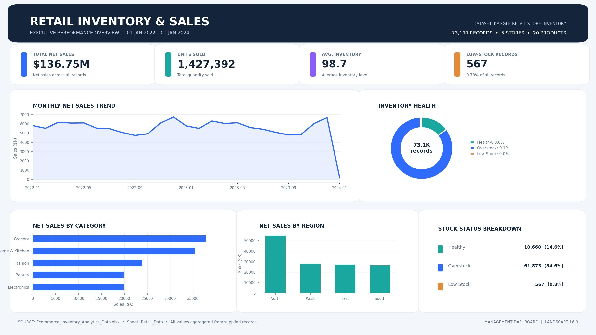

# 📊 Retail Sales & Inventory Data Analysis Using Excel

### Excel Data Analytics Portfolio Project

**Created by: Mansi Diwakar

## 📌 Project Overview

This project focuses on Retail Sales and Inventory Analysis using Microsoft Excel.

The dataset contains 73,100 records covering 5 stores, 20 products, 5 product categories and 4 geographical regions.

The project explores sales performance, product demand, inventory levels, stock status, regional trends and seasonal patterns.

The objective is to transform raw retail data into meaningful business insights through data preparation, Excel analysis and dashboard visualization.

## 🎯 Project Objectives

- Understand and prepare raw retail data.
- Perform data cleaning and validation.
- Analyze sales across different product categories.
- Compare regional sales performance.
- Explore monthly sales trends.
- Examine inventory and stock status.
- Present findings through an Excel dashboard.

## 🛠️ Tools & Technologies

- Microsoft Excel
- CSV Dataset
- Excel Formulas
- Pivot Tables
- Charts & Data Visualization
- Data Cleaning and Analysis

  ## 📂 Dataset Information

The project contains two CSV datasets:

### 1. Raw Sales Inventory Data
- Original dataset containing 73,100 records.
- Includes 17 columns related to sales, inventory, products, stores and market conditions.
- Covers the period from January 2022 to January 2024.

### 2. Processed Analytics Dataset
- Contains the same 73,100 records and 17 columns.
- Net Sales values are standardized to two decimal places.
- Prepared for further analysis and dashboard reporting.

  ## 🧹 Data Preparation

The raw and processed datasets were compared to understand the changes made during preparation.

The preparation process includes:

- Reviewing the original dataset structure.
- Checking records and column consistency.
- Verifying missing values and duplicate records.
- Standardizing Net Sales values to two decimal places.
- Preparing the processed dataset for Excel analysis.

The processed dataset retains all 73,100 records and 17 original columns.

## 🔍 Analysis Performed

1. Sales Performance Analysis
2. Category-wise Sales Analysis
3. Region-wise Sales Analysis
4. Store-wise Performance Analysis
5. Product-wise Sales Analysis
6. Monthly Sales Trend Analysis
7. Inventory Level Analysis
8. Stock Status Analysis
9. Demand Forecast Analysis
10. Seasonal Sales Analysis
11. Discount and Competitor Pricing Analysis
12. Weather and Promotion-related Analysis

### Dataset Dimensions
- Stores: 5
- Products: 20
- Categories: 5
- Regions: 4
- Stock Status: 3
- Seasons: 4

## 📁 Project Files

| File Name | Description |
|---|---|
| Raw_sales_inventory_data.csv | Original raw retail sales and inventory dataset |
| Sales_Inventory_Analytics_Data.csv | Processed dataset prepared for analysis |
| Retail_Sales_Inventory_Portfolio_Project (1).xlsx | Retail sales and inventory portfolio project workbook |
| Sales_Inventory_Interactive_Dashboard.xlsx | Excel interactive dashboard and KPI analysis |
| IMG_0177.jpeg | Dashboard preview image |

## 📈Dashboard Preview

## 📈 Key Performance Indicators

- Total Net Sales
- Units Sold
- Sales by Category
- Sales by Region
- Monthly Sales Trends
- Inventory Status

## 💡 Business Insights

Key findings and business recommendations will be documented here based on the completed analysis.

## 💡 Key Business Findings

- Grocery recorded the highest net sales among all product categories.
- Home & Kitchen ranked second in category-wise net sales.
- The North region generated the highest net sales.
- The dataset contains three inventory conditions: Healthy, Low Stock and Overstock.
- Overstock represents the largest stock-status group in the dataset.

These findings can help identify category performance, regional opportunities and inventory management patterns.

## ⚠️ Project Limitations

Profit and profit margin are not reported unless reliable product cost data is available.

## 📚 Dataset Source

The original dataset was supplied as a Kaggle-related CSV file.

Add the original Kaggle dataset page URL and relevant license/author attribution here before publishing.

## 👩‍💻 About the Author

**Mansi Diwakar**

B.Sc. (Hons.) Statistics Graduate  
University of Delhi | 2022

Aspiring Data Analyst | Interested in Excel, SQL, Power BI and Business Intelligence.

[Visit my GitHub Profile](https://github.com/mansi-diwakar)

---

⭐ Thank you for visiting my project!
